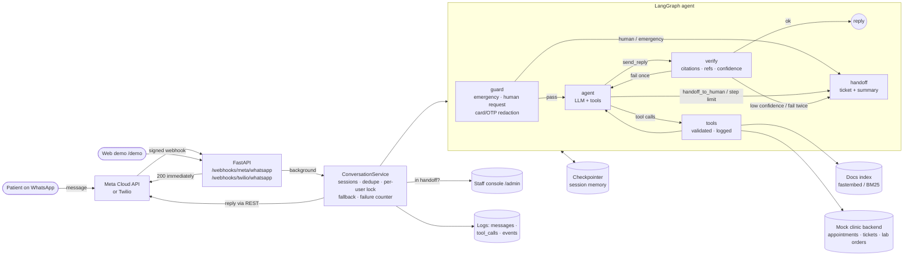

# Lotus Lane Dental — Multi-Channel AI Support Agent

A WhatsApp support agent for a (fictional) dental clinic. It answers questions **only from the clinic's documents** (RAG with enforced citations), **takes real actions** through tool calls (check availability, book appointments, create tickets, look up lab-order status), and **hands off to a human** when it is unsure, when the user asks, or when something breaks.

> All clinic data is invented for this demo. No real business, patient or employer data is used.

**Stack:** Python 3.12 · LangGraph · LangChain (any tool-calling LLM: Gemini / Groq / Ollama / OpenAI / Anthropic) · fastembed (local embeddings) · FastAPI · WhatsApp (Meta Cloud API or Twilio) · SQLite · Docker / Render

<!-- Replace with your own once deployed -->
**Live demo (available on request):** `https://blast-backdrop-paving.ngrok-free.dev/demo` · **WhatsApp:** `<how to message the test number>` · **Video:** `<link>`

---

## What it does

| Capability | How |
|---|---|
| Grounded answers | `search_clinic_docs` retrieves Markdown sections; the reply **must cite passage ids** that were actually retrieved and score above a relevance threshold, or it is not sent. |
| Actions | `check_availability`, `book_appointment`, `create_ticket`, `get_order_status` against a mock backend (SQLite) with real business rules: clinic hours, lunch break, double-booking protection, booking horizon. |
| Human handoff | Explicit request ("talk to a human"), emergency keywords, model's low confidence, failed grounding twice, repeated tool failures, step limit, or repeated system errors → ticket + session flips to *handoff* → staff answer from `/admin`. |
| Session memory | LangGraph checkpointer (SQLite) keyed by a per-user thread; new thread after 30 min idle. |
| Logging | JSON logs to stdout + `messages`, `tool_calls` (args, result, latency, error) and `events` (handoff, fallback, grounding_reject, error, guard…) tables, surfaced in the staff console. |
| Error handling | LLM timeouts/retries, tool errors returned to the model as data, fallback reply, auto-handoff after 2 consecutive failures, WhatsApp send retries, idempotent webhooks. |

## Architecture



### Why the graph looks like this

- **The LLM can only act through tools, and must end every turn with `send_reply`** (`tool_choice="any"`). That gives every reply a structured shape — `message`, `kind`, `source_ids`, `confidence` — that code can check.
- **`verify` is deterministic code, not another LLM call.** It rejects a reply when:
  - `kind="answer"` has no citations, cites a passage not retrieved this turn, or the passages score below the threshold;
  - it claims an action (`kind="action_result"`) but no action tool succeeded;
  - it mentions a booking/ticket/order reference (`APT-…`, `TKT-…`) that no tool returned (hallucinated confirmation);
  - it states prices without citing the docs.
  
  The model gets **one** chance to fix it (the rejection is fed back as a tool error); a second failure hands off to a human.
- **Safety-critical routing happens before the LLM.** Emergencies (e.g. swelling spreading to the eye, bleeding that won't stop) and requests for a person are matched in `guard`, so they never depend on the model.
- **Identity is injected by the tool executor, not chosen by the model.** `book_appointment` and `get_order_status` use the sender's id from the session; another patient's order needs last-name verification, and "not found" and "not yours" return the same error.

## Handoff rules

| Trigger | Where | Priority |
|---|---|---|
| User asks for a person ("talk to a human", "real person", "call me back") | `guard` (regex, no LLM) | normal |
| Emergency symptoms | `guard` → emergency advice + ticket | **urgent** |
| Model calls `handoff_to_human` (upset user, clinical judgement, out of scope) | `agent` | normal |
| Model sets `confidence="low"` | `verify` | normal |
| Reply fails grounding checks twice in one turn | `verify` | normal |
| 3 tool failures in one turn, or more than 6 agent steps | `tools` / `agent` | normal |
| 2 consecutive system errors (LLM down, crash) | `ConversationService` | high |

While a conversation is in handoff, the bot stays quiet (one acknowledgement per 10 minutes) so it never talks over staff; emergency detection still runs. Staff reply from `/admin` (delivered via WhatsApp) and click **Return to bot**, which starts a fresh memory thread.

## Failure handling

| Failure | Behaviour |
|---|---|
| LLM timeout / 5xx | Client retries (2) with timeout (25 s); then fallback reply; 2nd consecutive failure → handoff |
| LLM not configured | App still starts (`/health` shows `llm_ready: false`); all turns take the fallback path |
| Tool raises | Converted to `{"error": …}` and returned to the model; internals never leak; logged with latency |
| Bad tool arguments | Pydantic validation error returned to the model so it can correct itself |
| Embedding model download fails | Falls back to BM25 retrieval (logged) |
| Meta / Twilio retry the webhook | Deduplicated by message id (`wamid…` / `MessageSid`) |
| WhatsApp send fails | 3 attempts with exponential backoff on 429/5xx; then `send_failed` event with a hint for known error codes |
| Slow LLM vs webhook timeouts | Webhook answers 200 at once; the reply is sent asynchronously |
| Concurrent messages from one user | Per-user lock serialises turns, so memory stays consistent |
| Card numbers / OTPs in chat | Redacted before storage; never sent to the LLM |
| Forged webhook | `X-Hub-Signature-256` (Meta, HMAC with app secret) or `X-Twilio-Signature` validated → 403 |

## Getting started

> **New here?** [docs/SETUP.md](docs/SETUP.md) is the full step-by-step guide: which accounts and API keys you need, local setup, connecting WhatsApp (Meta Cloud API or Twilio) with ngrok, and deploying. The quick version follows.

### Prerequisites

- Python 3.11 or newer (`python --version`)
- A free LLM: a Google Gemini or Groq API key, or Ollama running on your PC (see step 2). No OpenAI key is needed.
- Internet access on first start: the embedding model (about 70 MB) downloads once and is cached

### 1. Create a virtual environment and install dependencies

Run these from the project folder.

**Windows (PowerShell)**

```powershell
python -m venv .venv
.venv\Scripts\Activate.ps1
pip install -r requirements-dev.txt
```

If PowerShell blocks the activate script, run `Set-ExecutionPolicy -Scope CurrentUser RemoteSigned` once, or use Command Prompt with `.venv\Scripts\activate.bat`.

**macOS / Linux**

```bash
python3 -m venv .venv
source .venv/bin/activate
pip install -r requirements-dev.txt
```

### 2. Choose an LLM and configure `.env`

Copy the example file (`copy .env.example .env` on Windows, `cp .env.example .env` elsewhere), then pick one option.

**Option A — Google Gemini (free, recommended).** Sign in at [Google AI Studio](https://aistudio.google.com/apikey), click **Create API key**, and set:

```ini
LLM_MODEL=google_genai:gemini-3.5-flash-lite
GOOGLE_API_KEY=your-key
ADMIN_TOKEN=any-long-random-string
```

The free tier has per-minute and per-day request limits (see your limits in AI Studio); they're enough for development and a demo. Google may use free-tier prompts to improve its products, which is fine here because all data is fictional.

**Option B — Groq (free).** Create a key at [console.groq.com/keys](https://console.groq.com/keys), and set:

```ini
LLM_MODEL=groq:llama-3.3-70b-versatile
GROQ_API_KEY=your-key
```

**Option C — Ollama (local, no key, no internet for the LLM).** Install [Ollama](https://ollama.com), run `ollama pull qwen2.5:7b`, and set:

```ini
LLM_MODEL=ollama:qwen2.5:7b
LLM_TIMEOUT_S=120
```

Local models are slower and follow the tool-calling rules less reliably, so expect more handoffs; it needs about 8 GB of free RAM.

Paid options also work: `openai:gpt-4.1-mini` with `OPENAI_API_KEY`, or `anthropic:claude-haiku-4-5` with `ANTHROPIC_API_KEY`.

WhatsApp settings (Meta or Twilio) can stay empty until you connect WhatsApp; the web demo works without them.

### 3. Check the install (optional)

```bash
pytest                       # 43 offline tests with a scripted fake LLM, no API key needed
python -m scripts.chat_cli   # chat with the agent in the terminal (uses your API key)
```

### 4. Start the application

```bash
uvicorn app.main:app --reload --port 8000
```

Wait for `app started` in the log, then open:

| URL | What it is |
|---|---|
| http://localhost:8000/demo | Web chat. Each answer shows its source documents; **Why this answer?** shows confidence and the checks it passed. Bookings and lab orders appear as cards, handoffs as a banner with the ticket reference. |
| http://localhost:8000/admin | Staff console. Sign in with your name and `ADMIN_TOKEN` to see today's numbers, the prioritised handoff queue, each conversation with its tool calls, the ticket and upcoming visits, and to reply (with snippets from the clinic docs). |
| http://localhost:8000/health | Status check. `llm_ready: true` means the API key worked. |

Stop the server with `Ctrl+C`. Conversations, bookings and tickets are kept in `data/app.db` and `data/checkpoints.db`; delete both files to start fresh.

### 5. Calibrate the relevance threshold (once)

```bash
python -m scripts.calibrate
```

Set `MIN_SCORE_DENSE` in `.env` to a value between the lowest in-scope score and the highest out-of-scope score, then restart the server.

### Run with Docker instead

```bash
docker build -t support-agent .
docker run -p 8000:8000 --env-file .env support-agent
```

### Troubleshooting

| Symptom | Fix |
|---|---|
| Every reply is "Sorry, I'm having a technical problem" | `/health` shows `llm_ready: false`: check the API key and `LLM_MODEL` in `.env`. If `llm_ready` is true, look for the error in the server log. |
| Log shows `429` / `RESOURCE_EXHAUSTED` | You hit the free tier's rate limit. Wait a minute (or until the daily reset), or switch to Groq or Ollama. |
| Log shows a model `404` / not found | The model name changed. Pick a current one from the provider's model list and update `LLM_MODEL`. |
| Ollama replies time out | Raise `LLM_TIMEOUT_S`, or use a smaller model such as `qwen2.5:3b`. |
| Log says `dense retriever unavailable, falling back to bm25` | The embedding model couldn't download. Check your internet or proxy, or set `RETRIEVER=bm25` to skip it. |
| `/admin` returns 403 | `ADMIN_TOKEN` is empty in `.env`. |
| Port 8000 already in use | Start with `--port 8001` and open that port instead. |

## Connect WhatsApp

Full walkthrough and troubleshooting: [docs/SETUP.md § 5](docs/SETUP.md#5-connect-whatsapp).

The app supports two providers and picks Meta automatically when its keys are set (`WHATSAPP_PROVIDER=auto|meta|twilio`):

| | Meta WhatsApp Cloud API (recommended) | Twilio |
|---|---|---|
| Cost to try | Free test number | Free trial |
| Bot replies | Work (within 24 h of the user's message) | Trial accounts can only send templates, so replies need an upgraded account |
| Webhook | `POST /webhooks/meta/whatsapp` (+ `GET` for verification) | `POST /webhooks/twilio/whatsapp` |
| `.env` | `META_ACCESS_TOKEN`, `META_PHONE_NUMBER_ID`, `META_APP_SECRET`, `META_VERIFY_TOKEN` | `TWILIO_ACCOUNT_SID`, `TWILIO_AUTH_TOKEN`, `TWILIO_WHATSAPP_FROM`, `PUBLIC_BASE_URL` |

Quick version (Meta): create a Meta developer app with WhatsApp → copy the Phone number ID and access token from **API Setup** and add your number under **To** → copy the App secret → pick a verify token → run `ngrok http 8000` → in **WhatsApp → Configuration** set the Callback URL to `https://<ngrok>/webhooks/meta/whatsapp` with your verify token, and subscribe to `messages`.

## Deploy

**Render:** push to GitHub → New → Blueprint → pick the repo (`render.yaml`) → fill the secret env vars → point the Meta (or Twilio) webhook at the live URL. The Docker build pre-downloads the embedding model and builds the index.

Any Docker host works: `docker build -t support-agent . && docker run -p 8000:8000 --env-file .env support-agent`. Mount a volume and point `DB_PATH` / `CHECKPOINT_DB_PATH` at it to keep data across restarts.

## Try these

| Message | Shows |
|---|---|
| "What are your opening hours?" | Grounded answer with citation |
| "Do you do dental implants?" | Answers from the "services we don't offer" section |
| "Book a cleaning tomorrow at 11" → give a name → "yes" | Availability check, confirmation, booking ref |
| "Status of ORD-1001" → last name "Sharma" | Order lookup with verification |
| "I need a duplicate invoice for last week" | Ticket creation |
| "Can you recommend a laptop?" | Out of scope → low confidence → handoff |
| "Talk to a human" | Deterministic handoff; then reply from `/admin` |
| "My face is swelling up to my eye" | Emergency advice + urgent ticket |

## Project layout

```
app/
  main.py               FastAPI: webhook, web demo, staff console API
  console.py            read models for the UIs (clinic status, queue, case, daily stats, doc snippets)
  service.py            sessions, memory threads, dedupe, fallback, handoff state
  agent/graph.py        LangGraph: guard → agent ⇄ tools → verify → handoff
  agent/guard.py        deterministic pre-LLM checks
  agent/prompts.py      system prompt and fixed replies
  tools/registry.py     tool schemas + logged, validated executor
  tools/backend.py      mock clinic backend (swap for real APIs)
  rag/retriever.py      Markdown chunking, fastembed / BM25 retrieval
  channels/whatsapp.py  picks the WhatsApp provider for outgoing messages
  channels/meta_whatsapp.py, channels/twilio_whatsapp.py
  static/demo.html, static/admin.html
data/docs/              the clinic's (fictional) FAQ and policy documents
scripts/                chat_cli, calibrate, warm_index
tests/                  offline tests with a scripted LLM
docs/                   case study draft, demo video script
```

## Screenshots

<!-- Add after deploying: docs/img/whatsapp.png, docs/img/demo.png, docs/img/admin.png -->
| WhatsApp | Web demo with reasoning trail | Staff console |
|---|---|---|
|  |  |  |

## Limitations and next steps

- Mock backend; swap `tools/backend.py` for a practice-management system and helpdesk.
- Rescheduling and cancelling go through tickets; direct self-service is a natural next tool.
- SQLite suits one instance; use Postgres (and `langgraph-checkpoint-postgres`) to scale out.
- Voice (Twilio Voice + speech-to-text) would reuse `ConversationService` unchanged.
- Add an offline eval set (question → expected source / expected handoff) to track answer quality per model.
